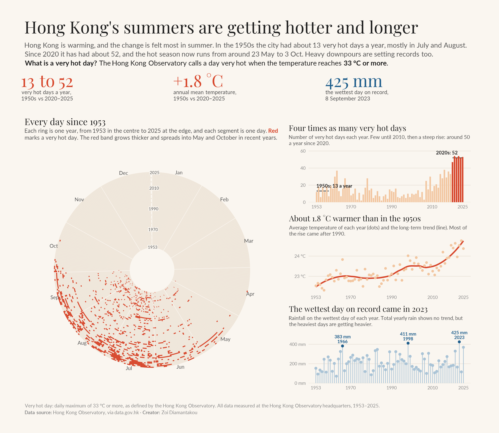

# Hong Kong's summers are getting hotter and longer

**A data story on 73 years of daily weather at the Hong Kong Observatory (1953–2025), built entirely in R.**

## The story

Hong Kong is warming, and the change is felt most in summer.

- **Four times as many very hot days.** In the 1950s the city had about 13 very hot days a year. Since 2020 it has had about 52, and every year from 2020 to 2025 had between 47 and 54. The rise was not steady: the number dipped in the 1980s and 1990s and took off after 2010.
- **A longer hot season.** In the 1950s the first very hot day came, on average, around 14 June and the last around 12 September. Since 2020 the season has run from around 23 May to 3 October.
- **A warmer year overall.** The annual mean temperature rose from 22.6 °C in the 1950s to 24.4 °C in 2020–2025, about 1.8 °C, with most of the rise after 1990.
- **Heavier downpours.** Total yearly rainfall shows no trend, but the wettest day of the year averaged 162 mm in the 1950s and 265 mm in the 2020s. The wettest day on record was 8 September 2023, with 425 mm.

**What is a very hot day?** The Hong Kong Observatory calls a day *very hot* when the temperature reaches 33 °C or more.

## How to read the infographic

| Part | Chart | What it shows |
|---|---|---|
| Big numbers | Key figures | The three main findings |
| Every day since 1953 | Radial calendar | One ring per year (1953 in the centre, 2025 at the edge), one segment per day; very hot days in red |
| Very hot days | Bar chart | Number of very hot days each year, with the 1950s and 2020s averages |
| Temperature | Dots and trend line | Annual mean temperature and its long-term trend |
| Rainfall | Lollipop chart | Rainfall on the wettest day of each year, top three labelled |

## Data

| File | Indicator | Source |
|---|---|---|
| `data/CLMMAXT_HKO_.csv` | Daily maximum temperature (°C) | Hong Kong Observatory, via [data.gov.hk](https://data.gov.hk) |
| `data/CLMTEMP_HKO_.csv` | Daily mean temperature (°C) | Hong Kong Observatory, via [data.gov.hk](https://data.gov.hk) |
| `data/daily_HKO_RF_ALL.csv` | Daily total rainfall (mm) | Hong Kong Observatory, via [data.gov.hk](https://data.gov.hk) |

### Data notes

- **One station.** All values are measured at the Hong Kong Observatory headquarters in Tsim Sha Tsui, the longest continuous record in Hong Kong. Other parts of the territory can be hotter or wetter.
- **Period.** The analysis covers 1953–2025: every year in this period has a complete daily record of all three indicators. The data for 2026 are left out because the year is not over.
- **Trace rainfall.** Days marked "Trace" (less than 0.05 mm) are counted as 0 mm.
- **Urban heat.** The station sits in a dense city, so part of the warming may come from urban growth around it, not only from climate change.

## Repo layout

| Path | What's inside |
|---|---|
| `hong_kong.R` | The full script: data, indicators, charts and layout |
| `hong_kong.png` | The infographic |
| `data/` | Daily maximum temperature, mean temperature and rainfall, as downloaded |

Made by [Zoi Diamantakou](https://github.com/ZoiDiama)
